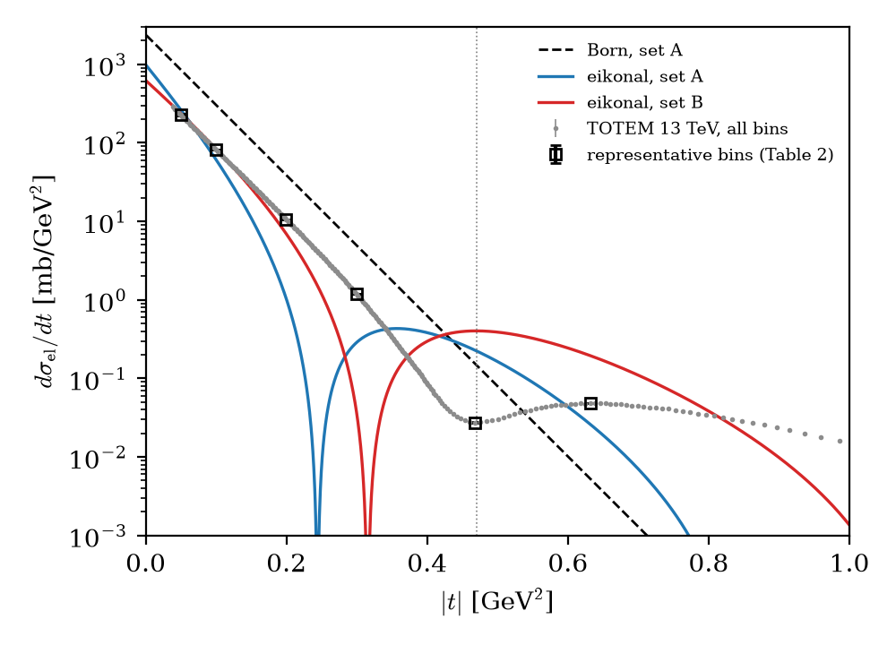
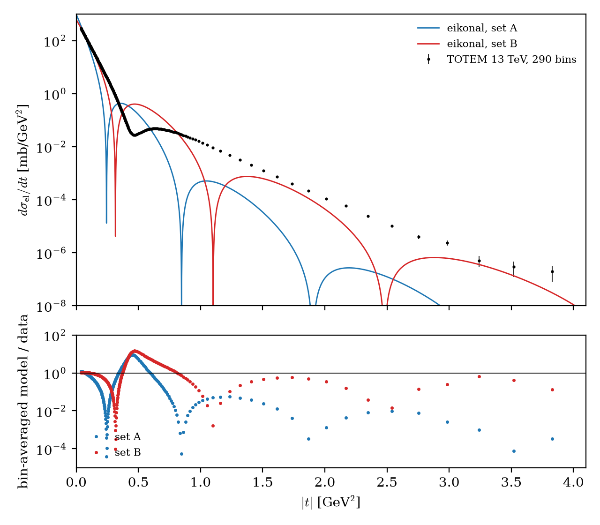
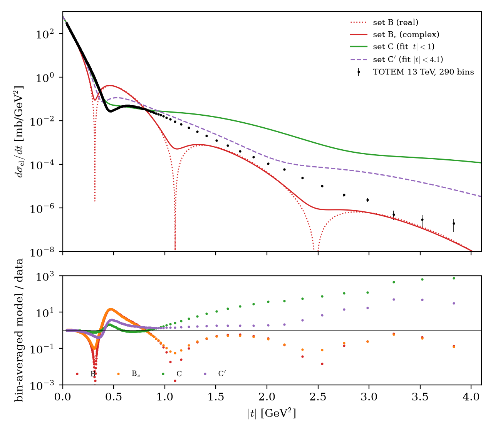

# Regge-eikonal pp

## 13 TeV

| 物理量 | A（固定参数） | B（校准） |
|---|---:|---:|
| 总截面 / mb | 139.233599 | 110.600000 |
| 弹性截面 / mb | 36.540221 | 31.078600 |
| 非弹性截面 / mb | 102.693378 | 79.521400 |
| 弹性/总截面比 | 0.262438 | 0.281000 |
| B(0) / GeV⁻² | 25.533627 | 18.831385 |
| 第一振幅零点 / GeV² | 0.244157 | 0.315492 |

[JSON](output/results.json) · [CSV](output/all_290_bins.csv)

## 对数残差 RMS

| 模型 | \|t\|<1 GeV² | 全部 bin |
|---|---:|---:|
| B（校准） | 1.799363 | 1.862940 |
| Bc（校准） | 1.203437 | 1.249996 |
| C（小区间拟合） | 0.205778 | 0.997001 |
| C′（全区间拟合） | 0.542086 | 0.708110 |

[小区间 JSON](output/extensions.json) · [全区间 JSON](output_t4/extensions.json)

## 微分截面

[PDF](figures/fig_dsdt.pdf)

## 截面与能量

[PDF](figures/fig_sigma.pdf)

## 弹性比例与前向斜率

[PDF](figures/fig_ratio_slope.pdf)

## 碰撞参数分布

[PDF](figures/fig_profile.pdf)

## 290-bin 比较

[PDF](figures/fig_full290.pdf)

## 扩展模型比较

[PDF](figures/fig_ext.pdf)

## 文件

[输入数据](data/TOTEM13_dsdt.csv) · [output](output/) · [output_t4](output_t4/) · [图](figures/) · [日志](logs/)
