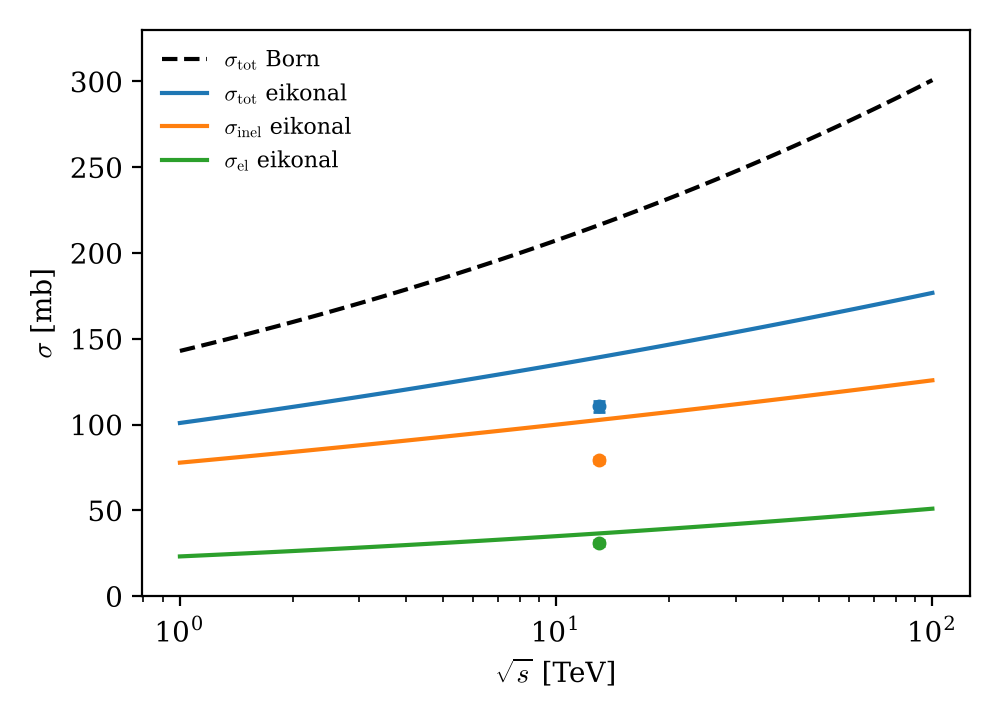
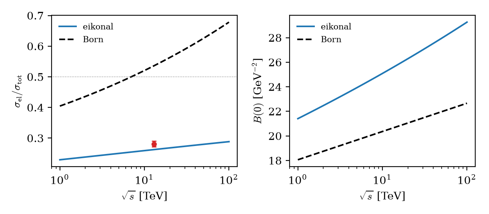
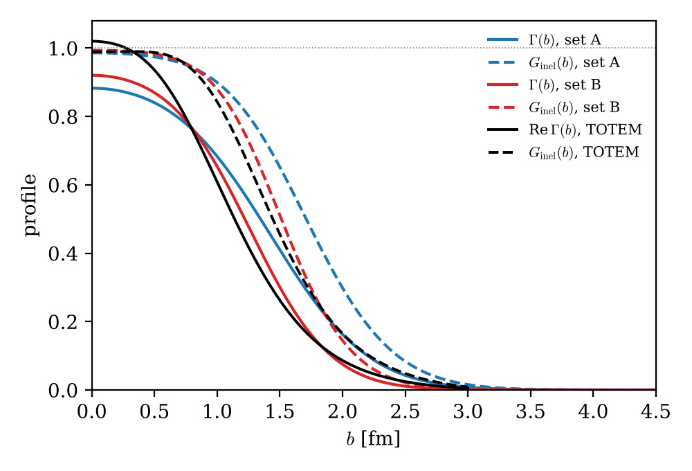
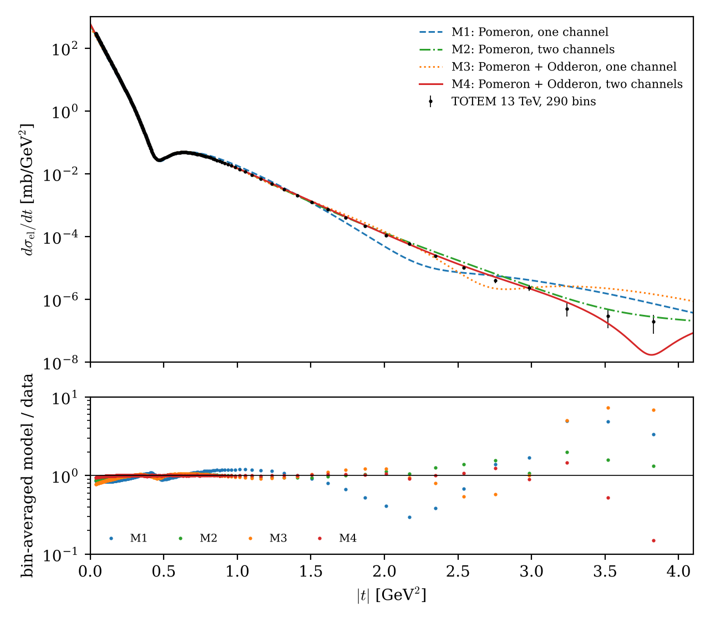
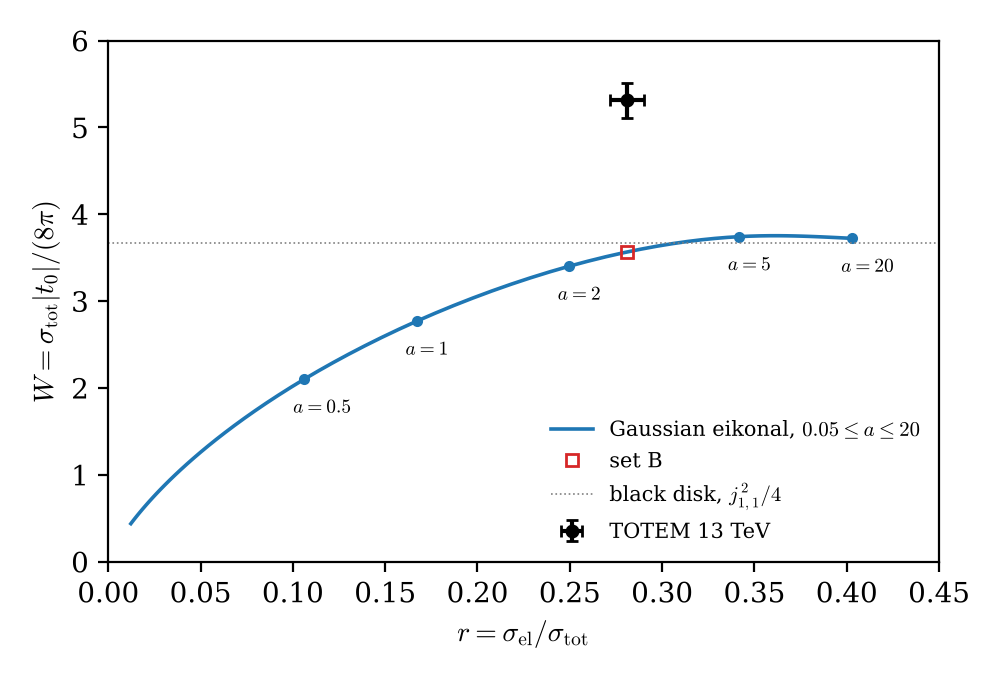

# Regge-eikonal pp

## 13 TeV

| 物理量 | A（固定参数） | B（校准） |
|---|---:|---:|
| 总截面 / mb | 139.233599 | 110.600000 |
| 弹性截面 / mb | 36.540221 | 31.078600 |
| 非弹性截面 / mb | 102.693378 | 79.521400 |
| 弹性/总截面比 | 0.262438 | 0.281000 |
| B(0) / GeV⁻² | 25.533627 | 18.831385 |
| 第一振幅零点 / GeV² | 0.244157 | 0.315492 |

[JSON](output/results.json) · [CSV](output/all_290_bins.csv)

## 对数残差 RMS

| 模型 | \|t\|<1 GeV² | 全部 bin |
|---|---:|---:|
| B（校准） | 1.799363 | 1.862940 |
| Bc（校准） | 1.203437 | 1.249996 |
| C（小区间拟合） | 0.205778 | 0.997001 |
| C′（全区间拟合） | 0.542086 | 0.708110 |

[小区间 JSON](output/extensions.json) · [全区间 JSON](output_t4/extensions.json)

## 微分截面

[PDF](figures/fig_dsdt.pdf)

## 截面与能量

[PDF](figures/fig_sigma.pdf)

## 弹性比例与前向斜率

[PDF](figures/fig_ratio_slope.pdf)

## 290-bin 比较

[PDF](figures/fig_full290.pdf)

## 扩展模型比较

[PDF](figures/fig_ext.pdf)

## 碰撞参数分布（含数据反演）

[PDF](figures/fig_profile.pdf) · [JSON](output/profile_inversion.json) · [CSV](output/profile_13TeV.csv)

由 290 个 bin 按式 (22) 反演：Re Γ(0) = 1.020，G_inel(0) = 0.989；各项变化下 Re Γ(0) 介于 1.002 与 1.038 之间。
Γ(0) = 0.99 的能量见 [energy_blackness.json](output/energy_blackness.json)。

## KMR 形状因子、Odderon 与两道 eikonal（模型 M1–M4）

| 模型 | σ_tot / mb | ρ | 第一极小 / GeV² | 极大/极小 | Re Γ(0) | χ²_dσ（290 bin） |
|---|---:|---:|---:|---:|---:|---:|
| M1 Pomeron，单道 | 106.6 | 0.102 | 0.476 | 1.99 | 0.951 | 4569 |
| M2 Pomeron，两道 | 103.7 | 0.098 | 0.469 | 1.89 | 0.971 | 733 |
| M3 Pomeron + Odderon，单道 | 96.6 | 0.004 | 0.468 | 2.00 | 0.934 | 2469 |
| M4 Pomeron + Odderon，两道 | 106.1 | 0.188 | 0.470 | 1.75 | 1.013 | 71 |

[PDF](figures/fig_kmr.pdf) · [JSON](output/kmr_fits.json)

## 单高斯 eikonal 的单参数曲线

W = σ_tot|t₀|/(8π) = Ein(a)·Q₀(a) 的最大值为 3.75（a = 6.8），TOTEM 13 TeV 为 5.31 ± 0.20。

[PDF](figures/fig_universal.pdf) · [JSON](output/universal_curves.json) · [CSV](output/universal_curve.csv)

## 程序

| 程序 | 内容 |
|---|---|
| regge_eikonal_pp.py | 第 IV 节闭合式，表 1、5、6 |
| full_comparison.py | 290 bin 比较，表 2，附录 B |
| extensions.py | 复振幅与双分量 opacity，表 3 |
| goodwalker.py | 高斯 profile 上的两道 eikonal |
| profile_inversion.py | 式 (22)–(23)，由数据反演 profile |
| energy_blackness.py | Γ(0) 达到 0.99 的能量 |
| kmr_fits.py | 模型 M1–M4，表 4（环境变量 MODELS、NSEED） |
| universal_curves.py | 式 (29)，单参数曲线 |
| figures/make_figures.py, figures/make_new_figures.py | 全部图 |
| compare.py | 程序输出与论文数字逐一比对 |

运行：`./run_all.sh`；比对：`python3 compare.py output/results.json Regge_eikonal_pp.tex`。

## 文件

[输入数据](data/TOTEM13_dsdt.csv) · [output](output/) · [output_t4](output_t4/) · [图](figures/) · [日志](logs/)
